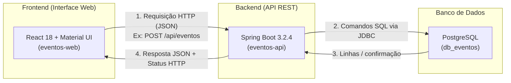
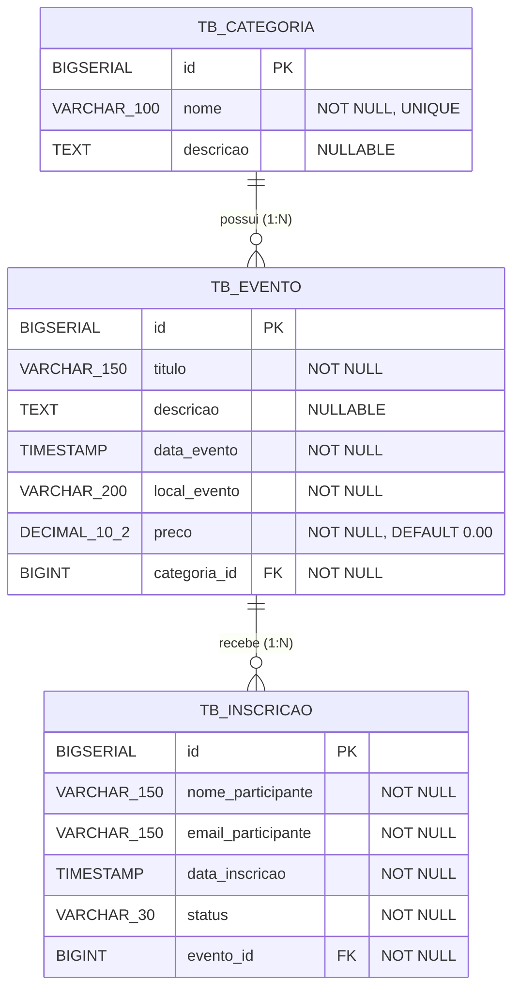

# Documentação Técnica — Sistema de Gerenciamento de Eventos e Inscrições

**Disciplina:** Banco de Dados 2 — 6º Semestre — Engenharia da Computação — **Universidade de Taubaté (UNITAU)**  
**Entrega:** Segunda entrega (`06/10/2026`)  
**Grupo:** Henrique Dias Ferreira, Vinicius Souza e Santos, João Pedro Beserra, Luan Eduardo Monteiro  
**Tecnologias:** Java 17, Spring Boot 3.2.4, React 18, Vite 5, Material UI (`@mui/material`), Recharts, Axios, PostgreSQL

---

## 1. Visão Geral e Arquitetura

O sistema gerencia **categorias**, **eventos** e **inscrições de participantes**, garantindo integridade referencial no PostgreSQL e gerando relatórios gerenciais diretamente no banco via **Native Queries**.



---

## 2. Banco de Dados Relacional (`db_eventos`)

O banco possui exatamente **3 tabelas** ligadas por dois relacionamentos **1:N**:



### Integridade Referencial, Cascata e Índices
- `tb_evento.categoria_id` → `tb_categoria(id)` com `ON DELETE CASCADE` (`fk_evento_categoria`) e índice `idx_evento_categoria`.
- `tb_inscricao.evento_id` → `tb_evento(id)` com `ON DELETE CASCADE` (`fk_inscricao_evento`) e índices `idx_inscricao_evento` e `idx_inscricao_email`.
- `tb_categoria.nome` possui constraint `UNIQUE`, impedindo categorias duplicadas.
- Os scripts `schema.sql` (`CREATE TABLE IF NOT EXISTS` / `CREATE INDEX IF NOT EXISTS`) e `data.sql` (`INSERT ... SELECT ... WHERE NOT EXISTS`) são idempotentes.

### Native Queries (Relatórios)

1. **`CategoriaRepository.gerarRelatorioAgregadoNativeQuery()`** (`GET /api/relatorios/agregacao-categoria`):
```sql
SELECT
    c.id AS categoriaId,
    c.nome AS nomeCategoria,
    COUNT(i.id) AS totalInscricoes,
    COUNT(DISTINCT e.id) AS totalEventos,
    COALESCE(SUM(e.preco), 0.0) AS faturamentoEstimado
FROM tb_categoria c
LEFT JOIN tb_evento e ON c.id = e.categoria_id
LEFT JOIN tb_inscricao i ON e.id = i.evento_id
GROUP BY c.id, c.nome
ORDER BY totalInscricoes DESC
```
- `LEFT JOIN` garante que categorias sem eventos ou inscrições continuem aparecendo com totais zerados.
- `COUNT(DISTINCT e.id)` evita duplicação na contagem de eventos quando há múltiplas inscrições.
- `COALESCE(..., 0.0)` evita retornos `NULL` em categorias vazias.

2. **`EventoRepository.obterEstatisticasEventosNativeQuery()`** (`GET /api/relatorios/estatisticas-eventos`):
- Executa `LEFT JOIN` entre `tb_evento` e `tb_inscricao`, retornando `totalInscritos`, `inscricaoConfirmada` (`SUM(CASE WHEN i.status = 'CONFIRMADA' THEN 1 ELSE 0 END)`) e `precoMedio` (`COALESCE(AVG(e.preco), 0.0)`).

---

## 3. Backend (`eventos-api`)

Arquitetura em camadas: `Controller` → `Service` → `Repository` → `Model/Entity`, utilizando DTOs com Bean Validation (`@Valid`, `@NotBlank`, `@NotNull`, `@Min`, `@Email`) e tratamento centralizado em `GlobalExceptionHandler` (`400`, `404`, `409`, `500`).

### Catálogo de Endpoints (19 principais + Health/OpenAPI)

| Recurso | Método | Rota | Descrição |
|---|---|---|---|
| **Categorias** | `GET` | `/api/categorias` | Lista todas as categorias |
| | `GET` | `/api/categorias/{id}` | Busca categoria por ID |
| | `POST` | `/api/categorias` | Cria nova categoria |
| | `PUT` | `/api/categorias/{id}` | Atualiza categoria existente |
| | `DELETE` | `/api/categorias/{id}` | Exclui categoria (e eventos em cascata) |
| **Eventos** | `GET` | `/api/eventos` | Lista todos os eventos |
| | `GET` | `/api/eventos/{id}` | Busca evento por ID |
| | `GET` | `/api/eventos/categoria/{categoriaId}` | Filtra eventos por categoria |
| | `POST` | `/api/eventos` | Cria novo evento |
| | `PUT` | `/api/eventos/{id}` | Atualiza evento existente |
| | `DELETE` | `/api/eventos/{id}` | Exclui evento (e inscrições em cascata) |
| **Inscrições** | `GET` | `/api/inscricoes` | Lista todas as inscrições |
| | `GET` | `/api/inscricoes/{id}` | Busca inscrição por ID |
| | `GET` | `/api/inscricoes/evento/{eventoId}` | Lista inscrições de um evento |
| | `POST` | `/api/inscricoes` | Cria nova inscrição |
| | `PUT` | `/api/inscricoes/{id}` | Atualiza dados e status da inscrição |
| | `DELETE` | `/api/inscricoes/{id}` | Exclui inscrição |
| **Relatórios** | `GET` | `/api/relatorios/agregacao-categoria` | Agregação por categoria (Native Query) |
| | `GET` | `/api/relatorios/estatisticas-eventos` | Estatísticas por evento (Native Query) |

> Endpoints auxiliares: `GET /api/health` e `GET /health` (`HealthController`), além da documentação Swagger UI em `/swagger-ui/index.html`.

---

## 4. Frontend (`eventos-web`)

SPA em React 18 + Vite 5 utilizando Material UI (`@mui/material`), tema claro com paleta Indigo (`#6366F1`) / Amber (`#F59E0B`), fonte Inter, Axios (com suporte a `VITE_API_URL` e timeout de 60s para cold start) e gráficos Recharts.

```text
eventos-web/src/
├── api.js                   # Cliente Axios centralizado e tratamento de erros HTTP
├── theme.js                 # Tema Material UI (cores, tipografia, bordas)
├── components/
│   ├── Layout.jsx           # Sidebar responsiva (Drawer fixo no desktop, menu no mobile)
│   ├── ConfirmDialog.jsx    # Diálogo de confirmação antes de excluir registros
│   └── EmptyState.jsx       # Estado vazio amigável com ação rápida
└── pages/
    ├── Dashboard.jsx        # Painel inicial com cards de resumo e guia rápido
    ├── Categorias.jsx       # Tabela e modal CRUD de categorias
    ├── Eventos.jsx          # Grade de cards com filtro por categoria e modal CRUD
    ├── Inscricoes.jsx       # Gestão de participantes e status (CONFIRMADA/PENDENTE/CANCELADA)
    └── Relatorios.jsx       # Gráficos (barras e pizza) e tabelas das Native Queries
```

---

## 5. Perguntas e Respostas para Defesa / Arguição

1. **Por que o relacionamento entre Categoria e Evento é 1:N e não N:N?**  
   Cada evento possui uma categoria principal única, simplificando a classificação e os relatórios financeiros por categoria. Caso um evento precisasse pertencer a várias categorias, seria necessária uma tabela associativa `tb_evento_categoria`.

2. **Por que utilizaram Native Query em vez de JPQL nos relatórios?**  
   Para atender ao requisito da disciplina e demonstrar domínio direto de SQL no PostgreSQL com `LEFT JOIN`, `COUNT(DISTINCT ...)`, `COALESCE`, `SUM` e `GROUP BY`, garantindo controle exato sobre o SQL executado.

3. **O que acontece ao excluir uma Categoria que possui Eventos?**  
   As chaves estrangeiras usam `ON DELETE CASCADE` (tanto no DDL `schema.sql` quanto no mapeamento JPA `CascadeType.ALL, orphanRemoval = true`), então excluir uma categoria remove em cascata seus eventos e respectivas inscrições. Essa decisão priorizou simplicidade didática; em um sistema de produção financeira, recomenda-se `ON DELETE RESTRICT` ou exclusão lógica para preservar o histórico.

4. **Como o sistema impede preços negativos e categorias duplicadas?**  
   - **Preço negativo:** validado no formulário do frontend e no backend com `@Min(value = 0)` em `EventoDTO`.
   - **Categoria duplicada:** garantido pela constraint `UNIQUE` em `tb_categoria.nome`, capturada pelo `GlobalExceptionHandler` e convertida em resposta `409 Conflict`.

5. **Para que serve `COALESCE` na Native Query?**  
   Substitui `NULL` por `0.0` quando uma categoria não possui eventos ou um evento não possui valor somado, garantindo retorno numérico consistente para os gráficos do frontend.

6. **Por que Frontend e Backend rodam em portas separadas localmente (`3000` e `8080`)?**  
   Pela separação entre SPA estática (Vite na porta `3000`, com proxy de `/api` para `8080`) e API REST (Tomcat embutido no Spring Boot na porta `8080`), permitindo deploy independente (Vercel + Render).
